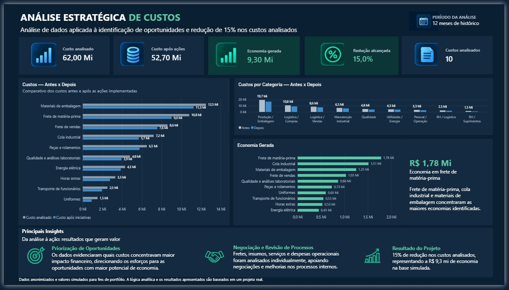
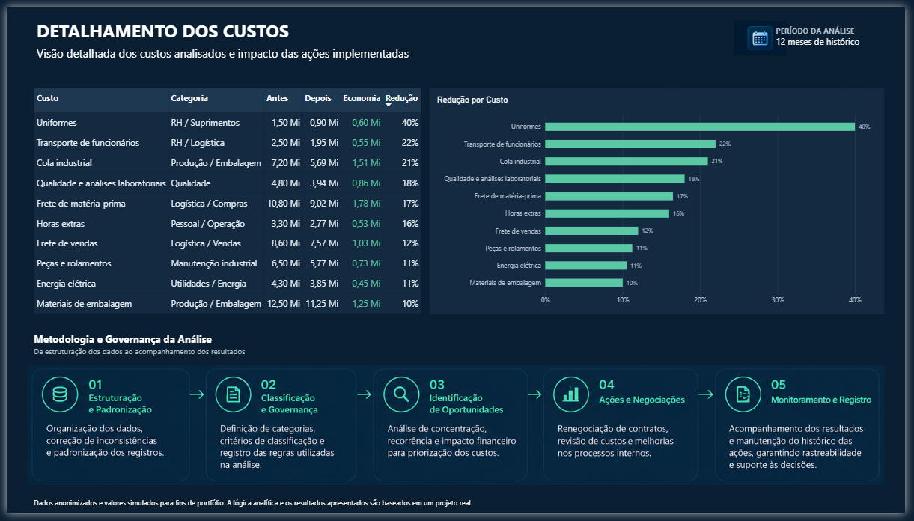

# 📊 Análise Estratégica de Custos | Power BI

Projeto de análise de dados aplicado à **Controladoria e Gestão de Custos**, desenvolvido a partir de uma experiência profissional real.

O objetivo foi estruturar e analisar dados históricos de custos para identificar oportunidades de economia, apoiar ações junto às áreas responsáveis e acompanhar os resultados após as melhorias implementadas.

> 🔒 **Confidencialidade:** os dados foram anonimizados e os valores apresentados neste repositório são simulados para fins de portfólio. A lógica analítica, as ações realizadas e o resultado percentual são baseados em um projeto profissional real.

---

## 🎯 Objetivo

Transformar dados históricos de custos em informações gerenciais que permitissem:

- identificar os custos com maior impacto financeiro;
- analisar concentração, recorrência e variações;
- priorizar oportunidades de redução;
- apoiar renegociações e melhorias de processos;
- comparar os cenários antes e depois das ações;
- comunicar os resultados de forma clara para a tomada de decisão.

---

## 🔎 Processo de análise

O projeto seguiu cinco etapas principais:

**1. Estruturação e padronização**  
Organização da base e tratamento das informações utilizadas na análise.

**2. Classificação e governança**  
Definição de critérios de classificação e padronização para tornar as análises consistentes.

**3. Identificação de oportunidades**  
Análise de volume financeiro, recorrência, concentração e variações para priorizar os custos com maior potencial de economia.

**4. Ações e negociações**  
Os dados apoiaram renegociações, revisão de custos e melhorias em processos internos junto às áreas responsáveis.

**5. Monitoramento dos resultados**  
Comparação dos custos antes e depois das ações para mensurar os resultados alcançados.

---

## 📈 Resultado

A análise e as ações realizadas contribuíram para uma redução de aproximadamente **15% nos custos analisados**.

No dashboard público, os valores financeiros foram simulados para preservar a confidencialidade das informações originais.

---

## 🛠️ Ferramentas e competências

- Power BI
- Power Query
- Modelagem de dados
- DAX
- Análise de Dados
- Business Intelligence
- Análise de Custos
- Controladoria
- Data Quality
- Governança de Dados

---

## 📊 Dashboard

### Visão Executiva

A primeira página apresenta os principais indicadores do projeto, a comparação entre os custos antes e depois das ações, a economia gerada e os principais insights da análise.

### Detalhamento dos Custos

A segunda página detalha os custos analisados, categorias, valores antes e depois das ações, economia e percentual de redução, além da metodologia utilizada.

---

## 📁 Arquivos do projeto

- `base-custos-simulada.xlsx` — base de dados simulada utilizada no dashboard
- `dashboard-analise-custos.pdf` — versão completa do dashboard em PDF
- `dashboard-visao-executiva.jpg` — visão executiva
- `dashboard-detalhamento.png` — detalhamento dos custos
- 💡 O arquivo .pbix não é disponibilizado publicamente neste repositório. Para fins de avaliação técnica, poderá ser fornecido mediante solicitação.

---

## 💡 Principais aprendizados

Este projeto reforçou que a análise de dados não termina na construção do dashboard.

O valor da análise está em **transformar dados em informações que ajudem a identificar problemas, priorizar oportunidades, apoiar decisões e acompanhar resultados**.

Também mostrou a importância da padronização, classificação e documentação dos dados para garantir análises mais consistentes e confiáveis.

---

## 👤 Autor

**Marcelo Souza Ramos**

Data Analyst | Power BI | SQL | Data Governance | FP&A
